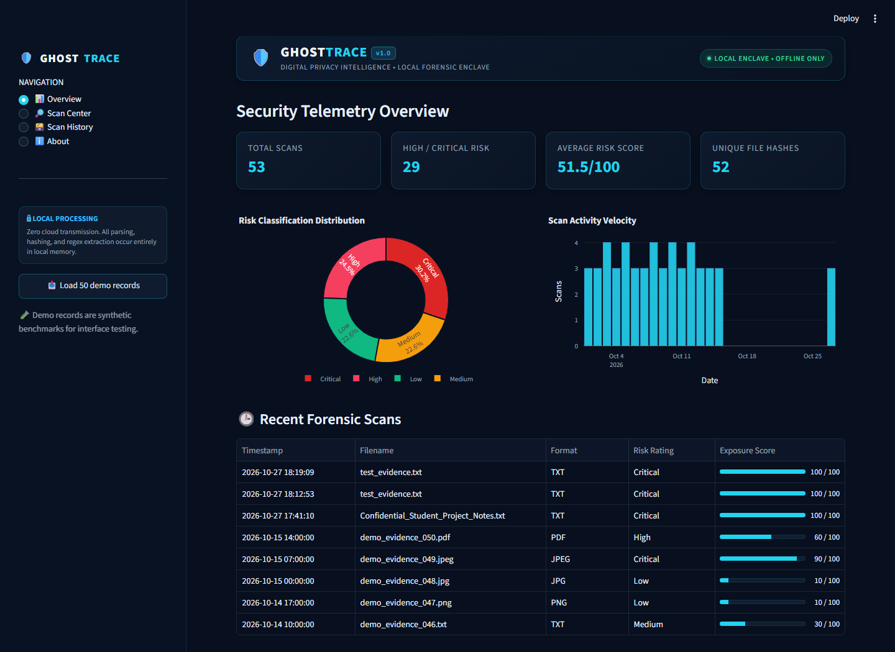
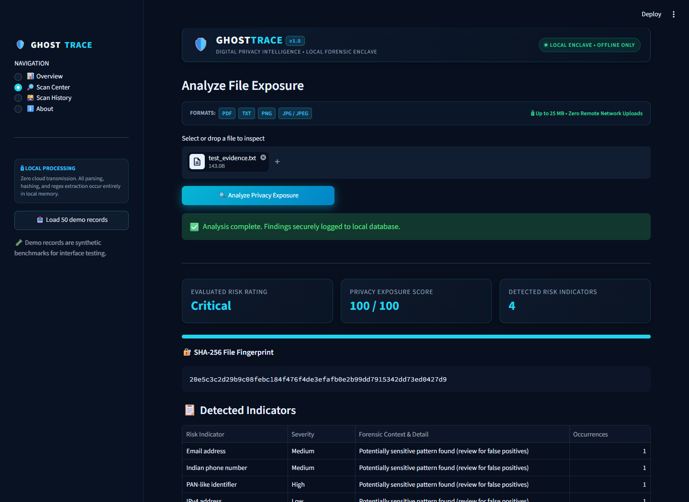
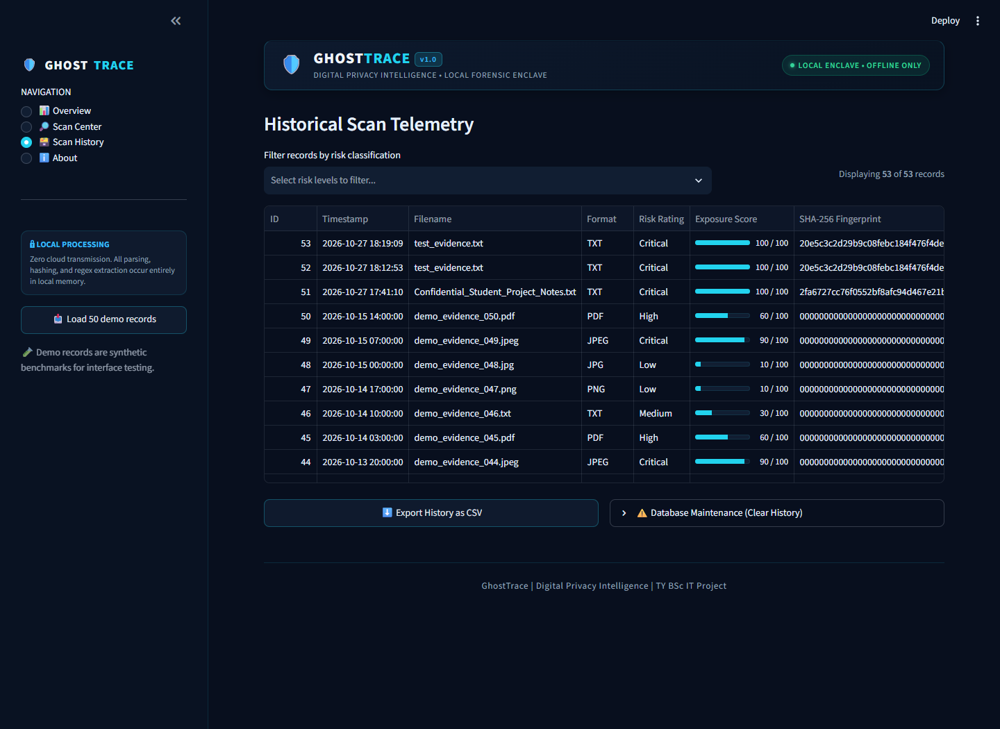

# 🛡️ GhostTrace — Digital Privacy Intelligence

[](https://www.python.org/)
[](https://streamlit.io/)
[](https://www.sqlite.org/)
[](https://github.com/)
[](https://github.com/)

> **GhostTrace** is an offline-first digital forensics and privacy intelligence enclave designed to identify accidental personal data leaks, hidden metadata, and exposure risks in files before they are shared.

---

## 📌 Executive Summary

Digital files frequently carry hidden layers of sensitive intelligence—from embedded author names, device models, and software build timestamps to GPS coordinates and unmasked personally identifiable information (PII). **GhostTrace** acts as a local security gateway, providing rapid heuristic risk evaluation, SHA-256 cryptographic verification, forensic PDF reports, and telemetry analytics without transmitting a single byte outside the host machine.

---

## ✨ Key Features

- **Multi-Format In-Memory Inspection**:
  - Analyzes **PDF, TXT, PNG, JPG, and JPEG** files (up to 25 MB).
  - All operations execute in system RAM; uploaded file contents are never written to disk or sent to third-party APIs.
- **Forensic Metadata Extraction**:
  - **PDF Documents**: Extracts creator software, author identity, producer tags, creation dates, and modification timestamps via PyMuPDF.
  - **Photos & Images**: Decodes EXIF metadata, camera device details, and identifies embedded GPS coordinates (latitude/longitude indicators).
- **PII & Sensitive Pattern Matching**:
  - Scans extractable text streams using heuristic regular expressions for:
    - Email addresses
    - Indian mobile number patterns (`+91` / 10 digits)
    - Permanent Account Number (PAN-like) tax identifiers
    - IPv4 network addresses
- **Explainable Privacy Exposure Scoring**:
  - Transparent heuristic weighting formula calculates an exposure score from `0` to `100`:
    - **Low Severity (+10)** | **Medium Severity (+25)** | **High Severity (+40)** | **Critical Severity (+60)**
    - Categorized into clear risk tiers: **Low**, **Medium**, **High**, and **Critical**.
- **Cryptographic Fingerprinting**:
  - Generates immutable SHA-256 cryptographic hashes for forensic integrity and deduplication.
- **Interactive Security Telemetry**:
  - Real-time Plotly charts: Risk distribution donut chart and scan velocity timeline.
  - Formatted KPI cards highlighting total scans, high-risk detections, average exposure, and unique file hashes.
- **Export & Reporting**:
  - Single-click **PDF Forensic Scan Reports** formatted with ReportLab.
  - Complete history export to **CSV** format for external audit workflows.
- **50 Synthetic Demonstration Records Included**:
  - Pre-packaged benchmark dataset (`data/sample_scans_50.csv`) allows instant evaluation of dashboards and tables.

---

## 🏗️ Technical Stack

| Component | Technology | Purpose |
| :--- | :--- | :--- |
| **Interface & Engine** | Streamlit | Responsive dark-mode dashboard & web enclave |
| **Data Manipulation** | Pandas | Record filtering, transformation, and aggregations |
| **Data Visualization** | Plotly Express | Interactive risk distribution and activity charts |
| **Image Forensics** | Pillow (PIL) | EXIF parsing and GPS metadata detection |
| **PDF Extraction** | PyMuPDF (fitz) | Document metadata and text stream extraction |
| **Report Generation** | ReportLab | Forensic audit report generation in PDF format |
| **Database** | SQLite3 | Local persistent scan history and audit log |
| **Integrity** | hashlib (SHA-256) | File fingerprinting and cryptographic hashing |

---

## 📁 Repository Structure

```plaintext
GhostTrace/
├── .streamlit/
│   └── config.toml           # Theme configuration (Dark Navy & Cyber Cyan)
├── app/
│   ├── __init__.py           # Package marker
│   ├── database.py           # SQLite schema and query operations
│   ├── reports.py            # ReportLab PDF report generator
│   └── scanner.py            # Core forensic inspection and scoring engine
├── data/
│   ├── ghosttrace.db         # Local SQLite database (auto-generated)
│   └── sample_scans_50.csv   # 50 synthetic benchmark records for testing
├── .gitignore                # Git exclusion rules for venvs, caches, and DBs
├── app.py                    # Main Streamlit application entry point
├── README.md                 # Project documentation
├── requirements.txt          # Python package dependencies
└── run.bat                   # 1-click Windows setup & launcher
```

---

## 🚀 Quickstart & Setup

### Prerequisites

- Python 3.11, 3.12, or 3.14 installed on your system.
- Ensure **"Add Python to PATH"** was checked during Python installation.

---

### Option 1: 1-Click Launch (Windows)

Double-click `run.bat` in the project root folder. The script will automatically create a virtual environment, install requirements, and launch Streamlit in your default browser.

---

### Option 2: Manual Terminal Setup

#### On Windows (PowerShell)

```powershell
# 1. Clone or extract the repository
cd GhostTrace

# 2. Create and activate a virtual environment
python -m venv .venv
.venv\Scripts\activate

# 3. Install dependencies
pip install -r requirements.txt

# 4. Launch the application
streamlit run app.py
```

#### On Linux / macOS

```bash
# 1. Navigate to project directory
cd GhostTrace

# 2. Create and activate virtual environment
python3 -m venv .venv
source .venv/bin/activate

# 3. Install dependencies
pip install -r requirements.txt

# 4. Launch the application
streamlit run app.py
```

Once running, navigate to `http://localhost:8501` in your web browser.

---

## 🧪 Testing with the Demo Dataset

GhostTrace includes an integrated demonstration suite:

1. In the left sidebar, click **"📥 Load 50 demo records"**.
2. The system imports exactly 50 synthetic cybersecurity scan records into local SQLite storage.
3. Switch to the **📊 Overview** tab to view live risk distribution charts, scan activity, and KPI cards.
4. Open the **🗃️ Scan History** tab to test risk filtering, inspect SHA-256 hashes, and export CSV logs.
5. Visit the **🔎 Scan Center** tab and upload a test file (e.g., a `.txt` file containing `test@example.com` or `+919876543210`) to perform a real-time scan.

---

## 🖼️ Application Screenshots

### 📊 Overview Dashboard & Security Telemetry



*High-level security telemetry featuring real-time KPI metrics, risk classification donut chart, scan activity velocity, and recent scan logs.*

### 🔎 Scan Center & Exposure Analysis



*Local in-memory file inspector displaying evaluated risk ratings, 0–100 privacy exposure scoring, SHA-256 cryptographic fingerprints, and detailed indicator occurrences.*

### 🗃️ Scan History & Telemetry Log



*Forensic scan history data grid with risk classification filtering, score progress indicators, CSV export, and database maintenance controls.*

---

## 🔒 Privacy, Security & Disclaimers

1. **Local Enclave Guarantee**: No file contents, scanned texts, or image bytes leave the local machine. All parsing happens inside the Python process runtime.
2. **Database Privacy**: SQLite stores only filenames, file extensions, SHA-256 hashes, summary risk labels, scores, and detected pattern categories. Raw file contents are never saved to disk.
3. **No OCR Processing**: Scanned image documents or image-only PDFs without an extractable text layer are not OCR-analyzed.
4. **Heuristic Assessment**: Risk scores are calculated using educational pattern matching and do not constitute a legal certification or exhaustive security audit.
5. **Authorized Testing Only**: GhostTrace should only be used to inspect files you own or have explicit authorization to assess.

---

## 🎓 Academic Attribution

- **Project**: GhostTrace — Digital Privacy Intelligence
- **Category**: Cybersecurity / Digital Forensics / Privacy Engineering
- **Curriculum**: TY BSc IT Capstone Project
